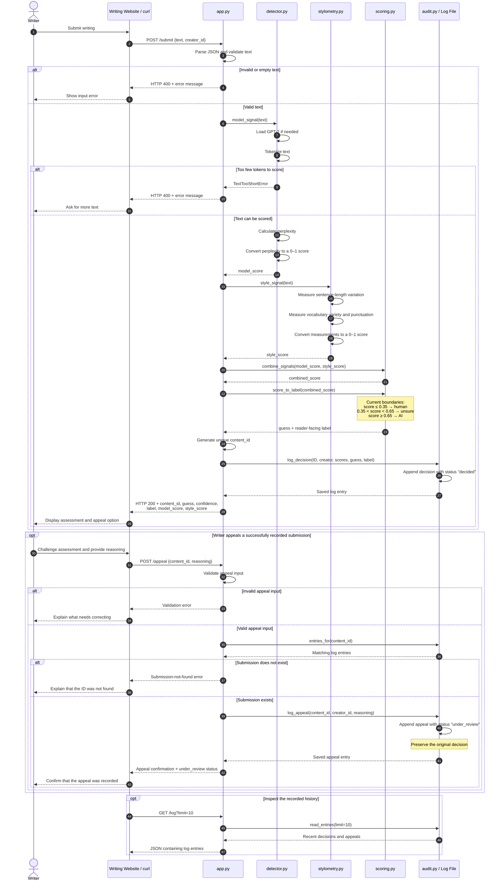

# Provenance Guard — Program Flow

This sequence diagram describes the complete intended flow for submission,
scoring, labeling, logging, and appeal. The current application implements only
part of this flow; the implementation notes below identify the remaining work.

The writing website is a possible client of this backend. During development,
`curl` can send the same requests directly.

## Full sequence diagram



## Scores and decisions

Both signals use the same direction: higher scores mean stronger evidence
toward AI authorship. The current combining rule is:

```text
combined_score = 0.7 * model_score + 0.3 * style_score
```

The response's `confidence` field is intended to carry this combined score.
It is a heuristic score, not a calibrated probability of AI authorship.

| Combined score | Guess |
| --- | --- |
| `0.00 ≤ score ≤ 0.35` | `human` |
| `0.35 < score < 0.65` | `unsure` |
| `0.65 ≤ score ≤ 1.00` | `ai` |

These boundaries reflect the current code in [config.py](config.py) and
[scoring.py](scoring.py). The human boundary written in
[criteria.md](criteria.md) is currently `0.45`, so the criteria and code still
need to be reconciled.

## Current implementation

| Component | Current behavior |
| --- | --- |
| [app.py](app.py): `submit()` | Validates that text is a non-empty string, runs the model, handles text-too-short errors, generates an ID, and logs the model score. It still returns a hardcoded response. |
| [detector.py](detector.py): `model_signal()` | Calculates a score from GPT-2 perplexity. |
| [stylometry.py](stylometry.py): `style_signal()` | Returns a fixed `0.5`; its three underlying measurements remain stubs. |
| [scoring.py](scoring.py): `combine_signals()` | Contains the starter weighted average, but `/submit` does not call it yet. |
| [scoring.py](scoring.py): `score_to_label()` | Applies the configured thresholds, but the label text is placeholder text and `/submit` does not call it yet. |
| [app.py](app.py): `appeal()` | Returns HTTP `501`, not implemented. |
| [audit.py](audit.py) | Provides helpers to append decisions and appeals, find entries by content ID, and read the log. |

The real model score and generated content ID currently reach the log, but
they do not reach the submission response. The response still looks like this:

```json
{
  "content_id": "hardcoded",
  "guess": "unsure",
  "confidence": 0.5,
  "label": "not built yet",
  "model_score": null,
  "style_score": null
}
```

An appeal records `under_review` while preserving the original decision.
Resolving that review or reversing the assessment is a separate step and is
not implemented by the supplied appeal logging helper.

## Supporting routes

| Route | Purpose |
| --- | --- |
| `POST /ping` | Check that the service receives and returns JSON. |
| `GET /health` | Inspect service status, model-loading status, rate-limiting configuration, and log count. |
| `GET /log` | Read recorded log entries; optionally limit the number returned. |

View this file in a Markdown viewer that supports Mermaid to render the
sequence diagram.
