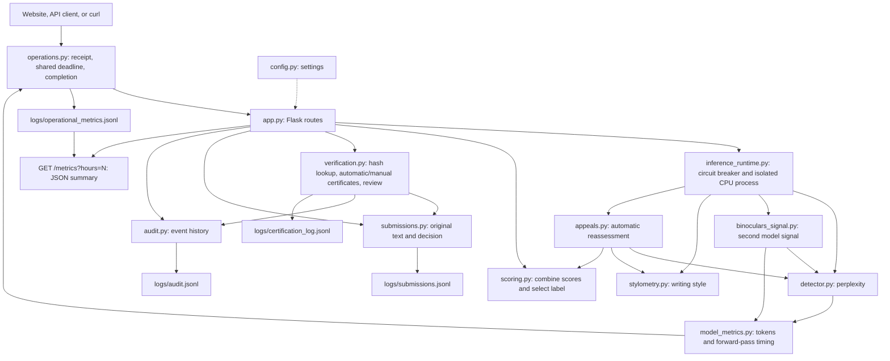
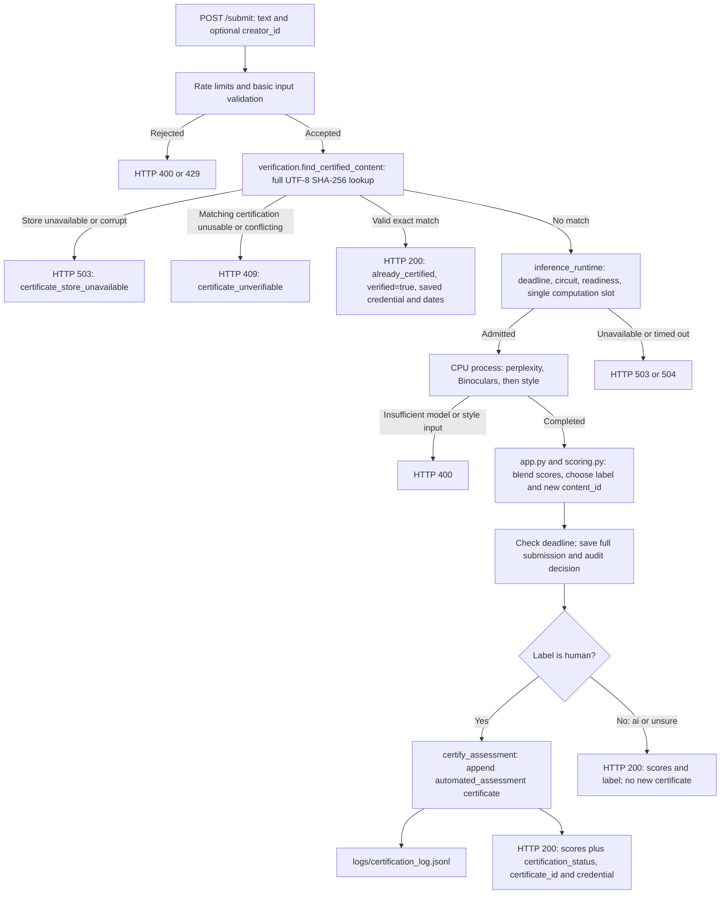
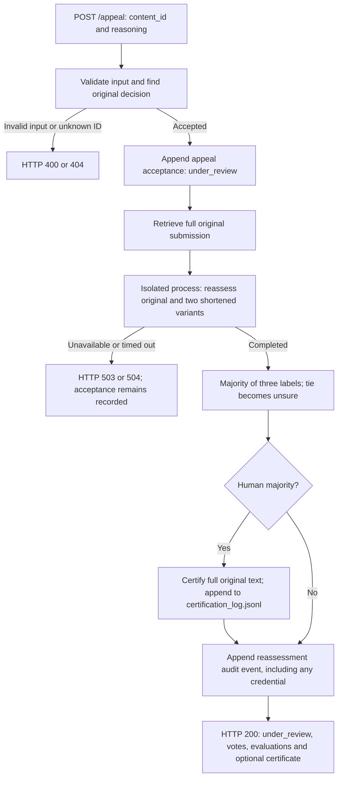
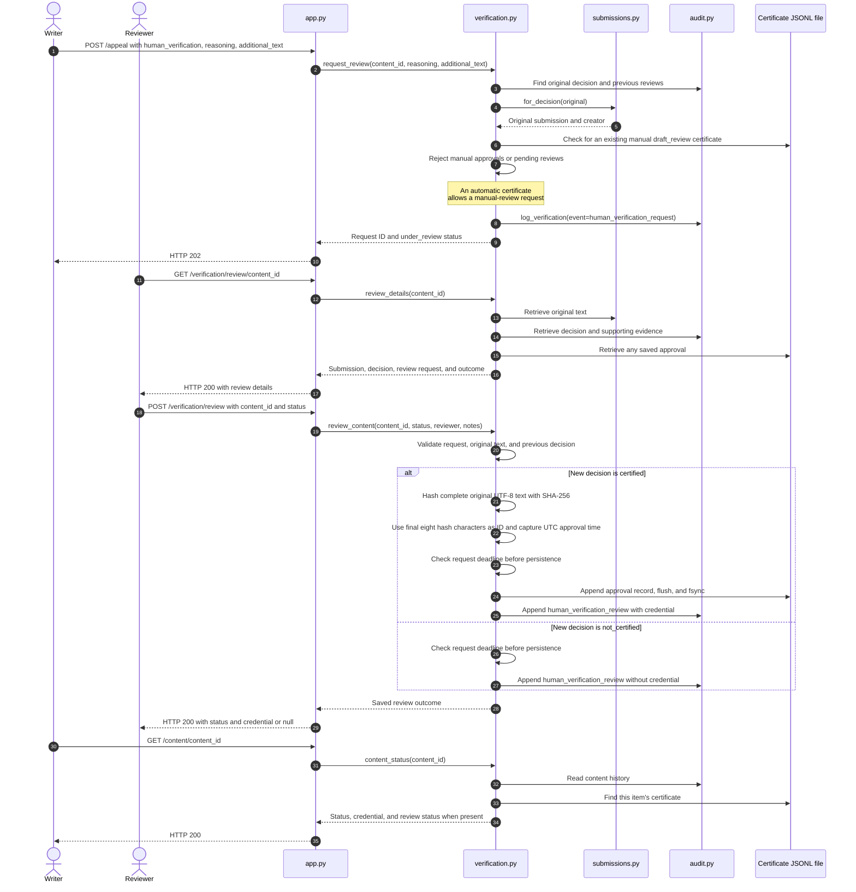
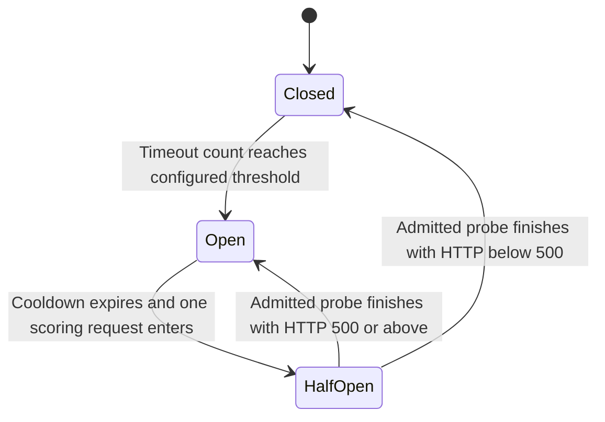
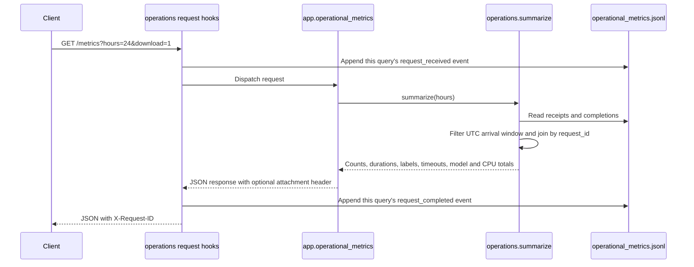
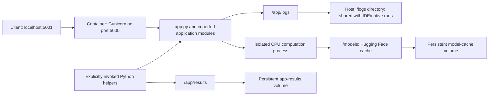
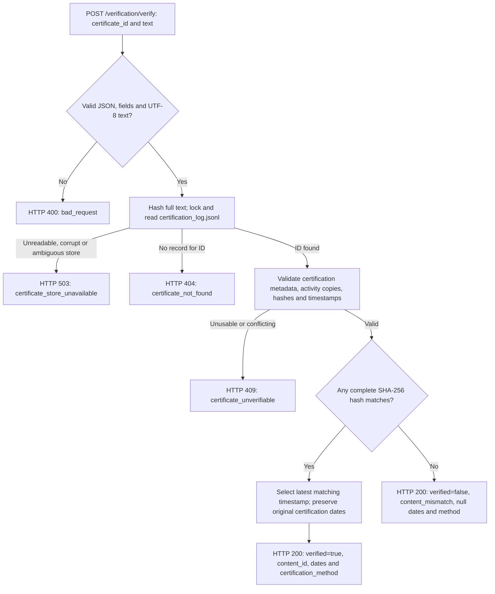

# Provenance Guard — Program Flow

This document follows the current application code, checked on **2026-11-18**:
submission, existing-certificate lookup, scoring, automatic certification,
appeals, manual review, certificate verification, request deadlines, circuit
breaker, operational metrics, and storage. The API is defined in
[app.py](app.py); the other application modules are called from those routes.
A writing website, an API client, or `curl` can send requests to the same service.

An exact match to already-certified text returns its saved certificate before
scoring. Otherwise, a `human` assessment or an approved manual review creates a
record in the same `logs/certification_log.jsonl` file. See
[RUNNING.md](RUNNING.md) for local/IDE and Docker launch instructions.

## Application components



[config.py](config.py) supplies model names, score weights, label boundaries,
rate limits, timeout/breaker flags, and file paths. Model inference, style analysis,
and automatic reassessment run in a separate persistent CPU process. It sends
measurements and results over a local pipe and never writes business records.
Flask owns the API, persistence, and operational logging. There are no separate
network services for these modules.

## API routes and the functions they call

Both run modes expose the same routes. **There is no homepage at `/`**: opening
the base address by itself returns 404. Use a complete GET URL in the browser.

### Docker: API access

The default host address is `http://127.0.0.1:5001`:

- [Health and model readiness](http://127.0.0.1:5001/health)
- [Statistics for the last 24 hours](http://127.0.0.1:5001/metrics?hours=24)
- [Download the statistics as JSON](http://127.0.0.1:5001/metrics?hours=24&download=1)

### Local Python/IDE: API access

The default address is `http://127.0.0.1:5000`. Use
[local health](http://127.0.0.1:5000/health) or
[local metrics](http://127.0.0.1:5000/metrics?hours=24); the paths and responses
are the same as in Docker.

### Shared route handlers

Use the paths as listed, without an extra trailing slash. POST routes need a
POST request with a JSON body; opening them in a browser address bar sends GET
and returns 405. The current Compose configuration mounts the repository's
`./logs` at `/app/logs`, so Docker and local/IDE runs use the same records.
Run one service instance at a time against that directory. A deployment on
another machine uses that machine's own `./logs` directory.

| Route | Function in `app.py` | Work delegated to other modules |
| --- | --- | --- |
| `POST /ping` | `ping()` | Echoes a message and identifies the service. |
| `GET /health` | `health()` | Checks inference readiness, optional-performer state, timeout/breaker settings, rate limits, and audit-entry count. |
| `POST /submit` | `submit()` | Calls `verification.find_certified_content()` first. On no match, runs scoring, saves the submission/decision, and calls `verification.certify_assessment()` for a `human` result. |
| `POST /appeal`, default or `review_type="automatic"` | `appeal()` | Logs acceptance, loads the original text, runs `appeals.reassess()`, certifies a `human` majority through `verification.certify_assessment()`, and logs reassessment. |
| `POST /appeal`, `review_type="human_verification"` | `appeal()` | Calls `verification.request_review()`. |
| `GET /verification/review/<content_id>` | `get_verification_review()` | Calls `verification.review_details()`. |
| `POST /verification/review` | `review_verification()` | Calls `verification.review_content()`. |
| `POST /verification/verify` | `verify_certified_content()` | Calls `verification.verify_content()` to compare full-text SHA-256 hashes for one certificate ID. |
| `GET /content/<content_id>` | `get_content()` | Calls `verification.content_status()`. |
| `GET /log` | `get_log()` | Calls `audit.read_entries()` or `audit.entries_for()`; supports `limit` and `content_id` filters. |
| `GET /metrics?hours=N&download=1` | `operational_metrics()` | Calls `operations.summarize()` for windowed request, status, label, timeout, token, and CPU statistics. `download=1` is optional. |

## Startup and readiness

1. Importing `app.py` creates Flask and installs `operations.install(app)` before
   Flask-Limiter. Each request therefore starts its measurements before rate
   limiting or route validation.
2. With Gunicorn, `gunicorn_conf.post_worker_init()` starts
   `inference_runtime.engine`. Native `app.main()` also starts it, only in the
   serving process when Flask's debug reloader is enabled.
3. `InferenceProcess` spawns a CPU process. Its `_worker()` loads GPT-2 and tries
   to load the optional Binoculars performer, then reports readiness over a pipe.
   Loading is outside the request deadline; weights stay in the process for
   subsequent requests.
4. `/health` reads `engine.snapshot()`. `inference_ready` describes the primary
   detector; `binoculars_loaded` and `binoculars_startup_error` describe the
   optional performer. Primary-model startup failure prevents scoring. An
   optional-performer failure preserves the existing perplexity-only fallback.
   HTTP 200 and `ok: true` alone do not mean the models are ready. Readiness also
   does not guarantee admission: an open circuit or busy worker can reject scoring.
5. Before readiness, a scoring request returns 503 `model_not_ready`. The HTTP
   service can still answer health, metrics, and certificate lookups. Docker's
   health check tests HTTP liveness; it does not require model readiness.
6. `gunicorn_conf.worker_exit()` closes the inference process; an `atexit` hook
   also registers cleanup. A scoring timeout kills and replaces the computation
   process. Idle-worker death is detected by a later health check, which starts
   a replacement. No abandoned scoring job is replayed.

## Submission and scoring

`POST /submit` accepts a JSON object with `text` and an optional `creator_id`.
An absent or invalid creator ID is stored as `unknown`.

After basic input validation, `verification.find_certified_content()` checks
the complete UTF-8 SHA-256 hash against saved certificates. An exact match with
valid certification metadata returns HTTP 200, `status="already_certified"`,
`already_certified=true`, `verified=true`, the message
`"This content is already certified."`, and the existing `certificate_id`,
`credential`, `content_id`, and `latest_certification_at`. This path requires no
model inference and adds no submission, review, or audit record. Operational
request logging and rate limiting still apply. An unmatched hash continues
through scoring below.
When that scoring returns `human`, `verification.certify_assessment()` writes
an `automated_assessment` certificate into the shared `config.CERTIFICATION_LOG`
and returns it with the scores. Automatic appeals with a `human` majority use
the same writer and bind the certificate to the complete original text.
Invalid matching approvals fail with 409; an unreadable or malformed certificate
store fails with 503. Certificate validation is shared with `/verification/verify`.
The lookup does not require a certificate ID from the caller. It compares the
full hash, validates related certification records, and selects the latest
matching certification by UTC timestamp, with file order breaking exact ties.
Different whitespace, punctuation, or Unicode changes the hash and leads to
normal scoring. The original creator and certification date remain unchanged.



The diagram shows normal outcomes and handled validation/operational failures.
An unexpected failure can still return HTTP 500. Perplexity, Binoculars, and style
calls cross `inference_runtime.call()` into the CPU process, all using the same
request deadline. Rate-limit and validation failures are measured before any
scoring starts. A timeout kills the compute process and returns 504 before saving
a submission; an open circuit, busy process, or unready model returns 503.
An existing-certificate match never enters that scoring circuit and remains
available while models load or scoring is paused, subject to the shared deadline
and operational logging. Invalid UTF-8 text fails hashing with HTTP 400.

The current sequence runs model inference before checking the style minimums.
Style analysis requires at least three sentences and 40 word tokens. Its
measurements are sentence-length spread, structural punctuation density, and
vocabulary diversity using a 50-word MATTR window.

The detector uses `gpt2` by default, overridable through
`AI201_DETECTOR_MODEL`. Binoculars uses `distilgpt2` as its performer and reuses
the detector as its observer. The model inputs are truncated to 400 tokens;
the saved submission retains the complete text.

The current `/submit` rule is:

```text
If Binoculars succeeds and len(text.split()) >= 100:
    model_score = round(0.5 * perplexity_score + 0.5 * binoculars_score, 4)
Otherwise:
    model_score = perplexity_score

combined_score = 0.7 * model_score + 0.3 * style_score
confidence = combined_score
```

Binoculars is currently computed even below the 100-word inclusion threshold.
If it raises `DetectorUnavailable`, submission scoring falls back to perplexity.
The blend above is performed directly in `app.py`; this path does not call
`scoring.combine_model_signals()`.

| Combined score | Returned `label` and `guess` |
| --- | --- |
| `0.00 <= score <= 0.45` | `human` |
| `0.45 < score < 0.60` | `unsure` |
| `0.60 <= score <= 1.00` | `ai` |

The newly scored response includes `http_status`, `content_id`, `guess`, `label`,
`label_text`, `combined_score`, `confidence`, `model_score`, and `style_score`. Perplexity,
Binoculars, the inclusion flag, and word count are saved in the decision records
but are currently commented out of the response payload. A `human` result also
includes `certification_status="certified"`, `certificate_id`, and `credential`.
The `already_certified` response returns the saved certification without new
score or classification fields.

Submission, decision, and certificate writes happen in that order in the HTTP
process. They are separate file appends, not one transaction across all files;
a later persistence failure can leave earlier writes present.

These scores are heuristics, not proof of authorship or calibrated probabilities.
Rate limiting is enabled for `/submit`: nine requests per minute and 400 per day,
applied independently to the IP address and each valid creator ID. Counts are
kept in memory and reset when the service process restarts.

## Automatic appeal

This is the default for `POST /appeal` when `review_type` is omitted. The caller
must provide an existing `content_id` and non-empty `reasoning`.

1. `app.py` finds the original decision with `audit.entries_for()`.
2. It calls `audit.log_appeal()` before inference, recording an `appeal_id`, the
   reasoning, and `status="under_review"`.
3. `submissions.for_decision()` retrieves the saved text. For older records, it
   can fall back to text embedded in the original audit decision.
4. `inference_runtime.call("appeal", original_text)` runs `appeals.reassess()` in
   the isolated process. It evaluates three variants: the original, the text
   without its first sentence, and the text without its last sentence.
5. Each variant is checked by style analysis first, then receives a perplexity
   score if scorable. The blend is 60% model and 40% style. This appeal path does
   not call Binoculars. It uses the same final label thresholds as submissions.
6. A label with at least two votes wins. A three-way tie returns `unsure`.
   Missing text, insufficient text, or an unavailable detector produces an
   `unsure` vote for the affected variant, with a recorded reason.
7. `verification.certify_assessment()` issues a certificate only for a `human`
   result, after checking the deadline. It hashes the complete original text,
   not a shortened appeal variant, and records `assessment_source="automatic_appeal"`
   with the `appeal_id` as `assessment_id`. Its credential is added to the result.
8. `operations.before_persist()` checks the remaining request budget before
   `audit.log_appeal_result()` appends the reassessment. The response includes
   the label, message, votes, evaluations, and weights, plus certification fields
   when a certificate was issued.



The original submission and decision remain unchanged. Automatic reassessment
keeps the appeal `under_review`. A `human` majority now adds an
`automated_assessment` certificate to the same store as manual reviews.
Malformed appeal input returns HTTP 400, and an unknown submission returns 404.
All three variants share the original request deadline. A timeout or inference
rejection can leave the initial appeal-acceptance event in the audit log; it
does not append a completed reassessment from abandoned work.

## Human review and certificates: who uses verification.py?

`app.py` imports [verification.py](verification.py) for submission hash lookup,
automatic certification from submissions and appeals, manual-review requests
and decisions, review details, content status, and verification against a
certificate. It also converts
`VerificationError` exceptions into JSON responses with the supplied HTTP code.

The diagram follows a valid new request and its first review decision. Error
responses and repeated decisions are described below it.



The review request must include non-empty `additional_text` containing the
supporting material. Requesting review does not grant a certificate. A reviewer
submits `status="certified"` or `status="not_certified"`; `reviewer` defaults to
`unspecified` and `review_notes` defaults to an empty string at the API boundary.
The current review endpoint does not authenticate the reviewer.

On approval, the credential contains `type="content_certification"`,
`method="draft_review"`, `Certificate_id=content_hash[-8:]` (eight lowercase hex
characters, no prefix), and `verified_dt_time` in UTC. New credentials also contain `hash_algorithm="sha256"`
and `content_hash`, computed from the complete original UTF-8 text. The same
credential is persisted in the certificate file and review audit event. The
surrounding review record ties it to a specific
`content_id`, creator, and verification request. Approval requires the original
text to be available and its creator to agree with the original decision.

Identical text approved under separate submissions shares a certificate ID and
full hash. Each approval appends its own history record with a distinct
`verification_request_id` and a UTC `timestamp` preserving microseconds. An
eight-character suffix can also be shared by different full hashes; lookup must
therefore compare the full hash. UUID-based historical certificate IDs are kept
unchanged and remain readable through their original IDs.

Verification changes are serialized with thread and file locks. Repeating the
same review decision returns the saved outcome and certificate; a conflicting
decision returns HTTP 409. A repeated approval can also recover the audit entry
if the certificate was saved but appending to the audit log failed. A declined
item can receive a new review request; an item already approved by a manual
review cannot. An automatic certificate still permits a later manual review.

Both certification methods use `schema_version=1` and a unique
`certification_event_id`, which can identify a future NoSQL document. Automatic
records have `event="automatic_certification"`, `assessment_source` (`submission`
or `automatic_appeal`), `assessment_id`, and the assessment details. Manual
records retain their reviewer and verification request fields. The credential's
method distinguishes the two processes. New event IDs are `ce_` followed by the
submission ID, automatic-appeal ID, or manual-review request ID. Repeating the
same automatic assessment ID returns its saved certificate; a new qualifying
appeal or approved manual review adds a certification activity.

Existing review credentials of type `verified_human` remain readable. On first
access, `verified_human_certification_log.jsonl` is renamed to
`certification_log.jsonl` without rewriting its records. If both files already
exist, the reader refuses to choose or overwrite either; submission lookup and
certificate verification return 503 until the files are reconciled. Older
certificates without usable hashes cannot verify, and historical `human`
decisions are not retroactively certified.

`content_status()` reads saved records without rescoring text. Its response
includes `content_id`, `status`, and `credential`; if a human-review request
exists, it also includes `verification_request_id` and `verification_status`.
Workflow status and certification are separate: an automatically certified
submission can still have `status="decided"`, and a certified automatic appeal
still has `status="under_review"`. The credential is the last appended
certificate for that content ID. A declined manual review does not delete an
earlier automatic certificate; the application does not implement revocation.

## Records and their owners

The data files contain one JSON object per line and are created on first write.
`config.LOG_DIR` resolves to `logs/` beside `config.py`, independently of the
process working directory. Both certification methods use
`config.CERTIFICATION_LOG = LOG_DIR / "certification_log.jsonl"` and the same
`_append_certificate()` writer, which flushes and fsyncs each new record.
The three business files are joined by `content_id`; operational receipts and
completions use `request_id` and include `content_id` when the response has one.

| File | Writer | Contents |
| --- | --- | --- |
| `logs/submissions.jsonl` | `submissions.save_submission()` | Complete original text, creator, timestamp, initial scores, label, and `decided` status. |
| `logs/audit.jsonl` | Helpers in `audit.py` | Initial decisions, submission rejections, automatic appeals and reassessments, human-review requests, and review outcomes. New submission decisions omit the full text; human-review requests include their supporting evidence. |
| `logs/certification_log.jsonl` | `verification.certify_assessment()`, `verification.review_content()` | Automatic `human` results and approved manual reviews with method, event ID, hash, and timestamps. Other labels and declined reviews do not create entries. |
| `logs/operational_metrics.jsonl` | Request hooks in `operations.py` | UTC arrivals/completions, route, HTTP status, wall/CPU seconds, label/result, historical timeout settings, circuit state, and per-model tokens and timings. No full request text. |

Reviews append new events rather than replacing the original submission.
The current-status endpoint combines the relevant saved history and certificate.
`GET /log` reads the audit file, not the submissions or certificate file directly.

Rate-limit, initial JSON/text, and insufficient-scoring-input rejections in
`/submit` have explicit audit entries. Certificate-store lookup errors do not
append business audit events. Validation failures on other routes also do not
all append such events, but every Flask request is
instrumented by the operational hooks, including 400, 429, 500, and timeout
responses. The operational file keeps performance measurements separate from
the business audit trail.

Each writer creates its parent folder if missing. `operations.append()` uses a
thread lock and an exclusive file lock when appending operational records. If
the request receipt cannot be written, the request returns 503
`operational_log_unavailable` before business work. If completion logging fails
after work has run, the error goes to the console and the response carries
`X-Operational-Metrics: unavailable`; an existing committed result is preserved.

## Deadline and metrics lifecycle

These defaults are defined in [config.py](config.py):

| Setting | Default | Effect |
| --- | --- | --- |
| `REQUEST_TIMEOUT_ENABLED` | `True` | Enforce the shared processing deadline. |
| `REQUEST_TIMEOUT_SECONDS` | `3` | Budget for one request, across all its computation stages. |
| `INFERENCE_PROCESS_ENABLED` | `True` | Use an isolated process that can be stopped. Inline mode is for mock-based tests with the timeout disabled. |
| `CIRCUIT_BREAKER_ENABLED` | `True` | Gate scoring after repeated timeouts. |
| `CIRCUIT_BREAKER_FAILURE_THRESHOLD` | `3` | Scoring timeouts without an intervening successful admitted request required to open the circuit. |
| `CIRCUIT_BREAKER_RECOVERY_SECONDS` | `30` | Cooldown before one recovery probe can enter. |
| `OPERATIONAL_METRICS_ENABLED` | `True` | Persist request receipts and completions. |
| `OPERATIONAL_LOG_FILENAME` | `operational_metrics.jsonl` | Performance/operations log under `LOG_DIR`. |
| `METRICS_DEFAULT_HOURS` / `METRICS_MAX_HOURS` | `24` / `720` | Default and maximum reporting window. |

The first seven settings accept environment overrides named `AI201_` followed
by the setting name; Boolean flags use `1` or `0`. Compose forwards the timeout,
breaker, and logging overrides and leaves process isolation enabled by default.
Timeout/recovery durations must be finite and positive, and the breaker threshold
must be at least one. Requests snapshot the settings they actually use, so later
reports retain historical values even after configuration changes and restarts.

1. The first Flask request hook snapshots the configured timeout and breaker
   settings, starts wall/thread CPU clocks, and writes a receipt. It runs before
   rate limiting, so a 429 still has an arrival and completion record.
2. Scoring checks the circuit, reserves the single inference slot, and sends work
   to the already-loaded process. Busy work returns 503 rather than waiting.
   Per-forward-pass token counts and timings stream back to the HTTP process.
3. All computation stages share the original deadline. On expiry, the worker is
   killed, partial measurements are retained, and the HTTP response is 504.
   Only model state is reloaded; an abandoned job is never replayed. Three
   scoring timeouts without an intervening successful admitted request open
   the breaker for 30 seconds by default.
4. Successful mutations check the deadline before persistence. Completion hooks
   record HTTP status, duration, CPU, result, and measurements, then release the
   inference slot. `X-Request-ID` links the response to its operational records.
5. `GET /metrics?hours=N` joins receipts and completions once per request, using
   arrival timestamps within the window. It reports all HTTP status counts but
   counts submission and automatic-appeal labels separately. A receipt without a
   completion remains visible, including the metrics request currently running.



`CircuitBreaker.enter()` admits at most one probe in the half-open state. Other
scoring requests receive 503 `circuit_open` with `Retry-After`. An admitted
request ending with HTTP below 500 resets the closed circuit's timeout count;
the same result closes a half-open circuit. An unsuccessful probe starts a new
cooldown. Validation and rate-limit failures before circuit admission do not
change its state. The circuit does not gate health, metrics, or certificate
lookups, including `already_certified` submissions, and its in-memory state
resets when the HTTP worker restarts. Non-timeout failures with HTTP 500 or above
do not reset the timeout count of a closed circuit.

| Operational outcome | HTTP status and JSON error | Effect |
| --- | --- | --- |
| Request deadline expires | 504 `request_timeout` | Includes request ID and timeout value; overdue scoring is stopped, while other handlers check deadlines cooperatively. |
| Circuit open or another probe active | 503 `circuit_open` | Reject scoring with `Retry-After`. |
| Computation slot already reserved | 503 `inference_busy` | Reject with `Retry-After`; scoring requests do not queue for that slot. |
| Primary model not ready | 503 `model_not_ready` | Wait for readiness or investigate the startup error. |
| Computation process exits during work | 503 `inference_unavailable` | Record incomplete CPU measurement and discard the failed process. |
| Timeout enabled but process isolation disabled | 503 `invalid_timeout_configuration` | Reject scoring because it cannot enforce cancellation safely. |

### Token, wall-time, and CPU measurements

`detector.perplexity()` and `binoculars_signal.binoculars_score()` wrap each
forward pass with `model_metrics.forward_pass()`. Started/completed measurements
stream to the parent collector using a unique `call_id`, so an update replaces
the same call's initial record rather than counting it twice.

| Model / stage | Newly scored submission | Automatic appeal |
| --- | --- | --- |
| GPT-2 / `perplexity` | One forward pass | One pass per scorable variant, up to three |
| GPT-2 / `binoculars_observer` | One additional forward pass | Not called |
| DistilGPT-2 / `binoculars_performer` | One forward pass when available | Not called |

These counts assume the default model pair and completed scoring. Existing
certificate matches, certificate verification, and manual review run no models.
An `already_certified` response therefore has no model-token measurements and
does not add a fresh classification to the metrics report.

`input_tokens` counts actual tokenized inputs after the 400-token limit for each
started pass, including repeated uses of the same text. `completed_input_tokens`
counts only completed passes; `scored_tokens` counts the prediction positions
used by completed scoring passes. Both models generate **zero `output_tokens`**.
Style analysis uses the request budget and CPU accounting but is not a model
forward pass. Per-model results are keyed by the configured model name.

`duration_seconds` is wall time from the first Flask request hook through
response construction, before writing the completion record or sending the
response. `cpu_time_seconds` adds the HTTP handler thread's CPU time and the
computation process's reported CPU time. Model startup and idle time are excluded.
CPU time can exceed elapsed time because PyTorch uses multiple CPU threads.
When a worker is killed before its total is reported, the request CPU total is
`null` and `cpu_measurement_complete` is false; completed forward-pass measurements
remain available. These are local compute measurements, not API billing tokens.

The default three-second limit is a server processing budget, excluding network
and server queuing. Metadata/file handlers check it cooperatively; process
shutdown and I/O can add overhead. A committed mutation keeps its real success
status even if it finishes late, with `deadline_exceeded` recorded. See
[RUNNING.md](RUNNING.md#request-timeouts-circuit-breaker-and-operational-metrics)
for the flags, exact measurement definitions, and report download commands.

## Metrics query and JSON download

`GET /metrics` defaults to the last 24 hours. The `hours` query parameter accepts
positive fractional values up to 720; invalid values return 400. `download=1`
adds `Content-Disposition: attachment` with a filename such as
`operational-metrics-last-24-hours.json`. Both modes return `application/json`.



| Report field | Meaning |
| --- | --- |
| `window` | Requested hours, UTC start/end, and `received_at` as the time basis. |
| `requests_received`, `requests_completed`, `requests_without_completion` | Unique requests, not raw JSONL line counts. A missing completion can mean in-flight work or a process interruption. |
| `requests_by_route` | Received requests grouped by HTTP method and route. |
| `average_response_time_seconds`, `response_time_seconds` | Completed-request average, min, max, p50, and p95; `null` if no requests have completed. |
| `classification_counts`, `classification_scope` | `human`, `ai`, and `unsure` from successful scored `POST /submit` responses. `already_certified` counts as a request and HTTP 200, but has no new classification. |
| `appeal_classification_counts` | Automatic-appeal labels, counted separately from new submissions. |
| `http_status_counts` | Completed responses, including 200, 400, 429, 503, 504, and other observed statuses. |
| `timeout_count`, `timeout_configurations` | Timeouts and request counts grouped by the recorded timeout value and enabled flag. |
| `circuit_breaker_rejections`, `circuit_breaker` | Historical rejection count and current circuit snapshot. |
| `current_timeout_seconds` | Current configured limit; historical settings remain separate. |
| `models`, `cpu_seconds` | Model pass/token totals and measured request CPU totals, with incomplete measurements identified. |
| `malformed_records_skipped`, `recording_enabled`, `note` | Corrupt-record count, current logging flag, and report-counting caveats. |

The report includes all routes, including health checks and metrics queries.
The current query contributes a receipt but not its own completion to the
returned statistics. The file is scanned on each query; malformed rows are
skipped and counted. Logging can be disabled, but unrecorded traffic cannot be
reconstructed later. There is no automatic rotation; sufficiently large files
can exhaust the metrics query's time budget. File-read failures return 503
`operational_log_unavailable`.

### Docker: download metrics from the host

```bash
curl -sS 'http://127.0.0.1:5001/metrics?hours=6&download=1' \
  -o operational-metrics.json
```

### Local Python/IDE: download metrics

```bash
curl -sS 'http://127.0.0.1:5000/metrics?hours=6&download=1' \
  -o operational-metrics.json
```

## Docker execution and persistent storage



[Dockerfile](Dockerfile) packages all root-level Python and Markdown files,
supporting documentation, and the small evaluation/attack fixtures allowed by
[.dockerignore](.dockerignore). Gunicorn starts `app:app` as a non-root user with
one HTTP worker, four threads, and debug mode disabled. `gunicorn_conf.py` starts
the isolated CPU process at worker initialization. The 300-second Gunicorn
watchdog is separate from the application's default three-second request budget.
[compose.yaml](compose.yaml) maps host port 5001 to container port 5000 on
loopback; every API route uses that same mapping. One HTTP worker shares the
in-memory rate limits and breaker, while its threads allow metadata requests
to run during scoring.

The deployment's `./logs` directory beside `compose.yaml` is mounted at `/app/logs`,
so audit records, submissions, certificates, and operational metrics are visible
in the host project and survive container replacement. Application paths remain
relative to the directory containing `config.py`, matching IDE/native runs
regardless of the process working directory. Run one service instance at a time
against these shared logs. The separate
`model-cache` volume is mounted at `/models`, and `app-results` is mounted at `/app/results`
for helper outputs. Host logs and these volumes are not included when the image
is exported. Docker uses the repository's existing logs directly.

Gunicorn's console logs are available through `docker compose logs app`.
The JSONL records are separate files inside `/app/logs`, also visible in the
host's `logs/` directory. The host directory must be writable by the non-root
application user; on Linux, its UID/GID is 10001. Download/preparation
helpers should direct their outputs to `/app/results`; Beemo uses that directory
as its working directory. See [RUNNING.md](RUNNING.md) for
startup, model preparation, and copying records out of the container.

## Supporting tools and documentation

### Docker: packaged helpers

These files are included in the Docker image. Helpers run explicitly via
`docker compose exec app python <script.py>`, rather than automatically by the
API. Markdown files remain documentation and evaluation inputs.

| Files | Role |
| --- | --- |
| `run_eval.py`, `scenarios.py`, `eval_samples/samples.json` | Historical five-criteria scoring evaluator. It captures responses and snapshots inputs/source, but assumes repeats return fresh scores; `already_certified` responses can invalidate its score-based checks. |
| `run_attacks.py`, `run_paced_attacks.py` | Exercise the live API with attack inputs and paced requests. |
| `calibrate.py`, `calibrate_combined.py`, `fit_perplexity.py` | Analyze model signals and candidate scoring settings using labeled samples. |
| `download_hc3_samples.py`, `prepare_calibration_samples.py`, `beemo_file_download.py` | Download or prepare datasets and sample inputs. |
| `test.py`, `test_*.py` | Check the environment and test application behavior. |
| `test_automatic_certification.py`, `test_submit_certification.py`, `test_content_verification.py`, `test_verification.py`, `test_operations.py` | Cover automatic/manual issuance, exact-hash reuse, migration, certificate validation, request budgets, circuit recovery, and metrics. See the isolated regression commands in `RUNNING.md`. |
| `criteria.md`, `README.md`, `RUNNING.md`, `PROGRAM_FLOW.md` | Record acceptance targets, project evidence, operating instructions, and this flow. Flask does not use Markdown files to make scoring decisions. |

Dependencies are installed from `requirements-docker.lock`, generated using
`requirements-docker.in` and the original `requirements.txt`. The Docker input
also includes `scikit-learn` for fitting and `datasets` for Beemo downloads.
Source/docs and small fixtures are copied separately; existing logs, generated
results, and large downloaded datasets are excluded. Helpers that call the
running API from inside its container use `http://127.0.0.1:5000`.
Attack runners retain responses, but their older label/score-based judgments
need review when the API returns `already_certified`. See
[current checks and legacy limitations](RUNNING.md#current-certification-and-operational-regression-checks).

## Verify content against a certificate

`POST /verification/verify` accepts a JSON object containing `certificate_id`
and `text`. `app.verify_certified_content()` validates the JSON object and calls
`verification.verify_content()`. It accepts certificates issued by either
automatic assessment or manual review. This endpoint differs from normal submission:

| Input / outcome | `POST /submit` | `POST /verification/verify` |
| --- | --- | --- |
| Required fields | `text` | `certificate_id`, `text` |
| Valid exact certified text | 200 `already_certified`, saved credential, no inference | 200 `verified: true`, `status: "verified"`, no inference |
| Different text | Normal scoring; a new `human` result creates a certificate | 200 `verified: false`, `status: "content_mismatch"`; never scores |
| No certificate record | Normal scoring | 404 `certificate_not_found`, including a missing or empty file |

The verification function:

1. Requires a non-empty certificate ID and text, then hashes the complete UTF-8
   text through `_content_hash()` without trimming, normalization, or model-token
   truncation. The same helper is used during certificate issuance.
2. Reads the shared certificate file under the same lock used for certification
   and review writes. A legacy filename is migrated before reading.
   `_certificate_object()` rejects duplicate JSON field names, including nested
   credential fields, before any value can overwrite another. The lookup then
   finds the supplied ID in `credential.Certificate_id`.
3. Validates the matching records' automatic/manual certification metadata,
   full SHA-256 hashes, and dates through `_validated_certifications()`.
   Eight-character IDs must equal the stored hash suffix. `_activity_keys()`
   checks for conflicting copies identified by `certification_event_id`,
   `verification_request_id`, or `assessment_id`.
4. Uses `hmac.compare_digest()` to find records whose full hash matches the
   presented text. Matching the short suffix alone never establishes verification.
5. Selects the matching record with the latest UTC approval timestamp, using
   append order only for exact timestamp ties. `_certification_time()` validates
   that its precise event timestamp and displayed UTC certification date agree.



The shared request hooks record this lookup and can still return operational
errors such as 504 `request_timeout`; the diagram shows the verification-specific
branches.

The response is HTTP 200 with `verified: true` and `status: "verified"` for a
match, or `verified: false` and `status: "content_mismatch"` for different text.
Success includes the latest matching approval's `content_id`, `verified_dt_time`,
and precise ISO 8601 UTC `latest_certification_at`, alongside the certificate ID,
hash algorithm, and `certification_method` (`automated_assessment` or `draft_review`).
Repeated certifications are valid history, not a duplicate-ID
error. If different full hashes share the short ID, each text resolves only to
its own matching history. A mismatch returns null timestamps and method, and also a null
content ID when the suffix spans multiple full hashes. Invalid input returns
400, an unknown ID returns 404, and unusable metadata or conflicting copies of
one certification activity return 409. An unreadable, malformed or duplicate-field
certificate file returns 503. Certificate-validation errors include
`verified: false`; shared operational errors instead carry the generic error
payload. Examples are 504 `request_timeout` and 503 `operational_log_unavailable`
when the initial operational receipt cannot be written; neither includes `verified`.

This operation does not run inference or alter the submission, certificate,
audit history, or content status. The saved hash remains usable after a process
restart and does not depend on rereading the current submission text. Old
certificates are not silently backfilled, and repeated approvals preserve the
original credential. Verification access also appears in Gunicorn's logs and in
the separate operational file, which captures `verified`, result status, HTTP
status, and request timing without changing the certificate or business audit.

The returned dates describe the latest successful certification of the presented
text under the supplied ID. A lookup does not refresh them. Retrying approval of
an already-approved manual review preserves its existing record. A new qualifying
automatic appeal or a later approved manual review adds a certification activity
even for the same original submission. Normal resubmission of certified text
reuses its existing certificate. Content-status and review-detail endpoints
retain their per-submission history.

The check establishes a match with this deployment's stored certified version.
It is not a public-key signature or an independent proof of human authorship;
it relies on the recorded automatic assessment or manual review and the integrity
of stored records. `certification_method` identifies which process was used.

<a id="new-methods-and-changed-entry-points"></a>

## Runtime methods and application entry points

The following inventory maps the current runtime methods and application
entry points to their roles. Hook names below `install()` are nested functions
registered on the Flask application, not separate API endpoints.

| Module | Methods / functions | Responsibility |
| --- | --- | --- |
| `operations.py` | `DeadlineExceeded`, `current()`, `check_deadline()`, `before_persist()` | Access request state, signal budget expiry, and guard successful writes. |
| `operations.py` | `RequestState.__init__()`, `RequestState.common()` | Initialize request ID, timers, configuration snapshot, collector, and shared event fields. |
| `operations.py` | `log_path()`, `append()` | Resolve and append to the separate operational file under locks. |
| `operations.py` | `install()`, `install.begin_request()` | Install hooks and record arrival before rate limiting. |
| `operations.py` | `install.timeout_response()`, `install.unavailable_response()` | Convert timeout and inference rejection into JSON 504/503 responses. |
| `operations.py` | `install.finish_request()`, `install.finish()`, `install.finish_failed_request()` | Finalize metrics, update the breaker, release computation reservation, and clean request context even on errors. |
| `operations.py` | `_timestamp()`, `_percentile()`, `summarize()` | Parse time windows, calculate latency percentiles, and aggregate deduplicated requests. |
| `inference_runtime.py` | `InferenceRejected.__init__()` | Carry a rejection code, message, and optional retry delay. |
| `inference_runtime.py` | `CircuitBreaker.__init__()`, `CircuitBreaker.enter()`, `CircuitBreaker.finish()`, `CircuitBreaker.snapshot()` | Initialize and transition the closed/open/half-open circuit and expose its state. |
| `inference_runtime.py` | `InferenceProcess.__init__()`, `InferenceProcess.start()`, `InferenceProcess.close()` | Own and manage the isolated process, pipe, guard, and per-request reservation. |
| `inference_runtime.py` | `InferenceProcess._start_locked()`, `InferenceProcess._stop_locked()`, `InferenceProcess._refresh_locked()` | Spawn/stop the process and consume startup or process-death state under its guard. |
| `inference_runtime.py` | `InferenceProcess.snapshot()`, `InferenceProcess.run()` | Expose readiness and execute work with the remaining request budget. |
| `inference_runtime.py` | `_worker()`, `_execute()` | Load models, dispatch perplexity/Binoculars/style/appeal jobs, and stream results and measurements. |
| `inference_runtime.py` | `call()`, `release()` | Apply deadline and circuit checks, reserve the computation slot, and release it on completion. |
| `model_metrics.py` | `Collector.__init__()`, `Collector.update()`, `begin()`, `end()` | Maintain a context-local call collector and optionally send updates over the pipe. |
| `model_metrics.py` | `forward_pass()`, `summarize()` | Measure model tokens and CPU/wall time, then aggregate by model name. |
| `gunicorn_conf.py` | `post_worker_init()`, `worker_exit()` | Start and close computation with the HTTP worker lifecycle. |
| `app.py` | `health()`, `main()` | Report readiness and operational settings; start computation for native serving. |
| `app.py` | `submit()`, `appeal()` | Look up existing certificates before submission scoring, delegate computation, persist decisions, and certify new `human` assessments. |
| `app.py` | `verify_certified_content()`, `operational_metrics()` | Serve certificate hash checks and windowed operational JSON reports. |
| `detector.py`, `binoculars_signal.py` | `perplexity()`, `binoculars_score()` | Instrument existing forward passes without changing their scoring formula. |
| `verification.py` | `_content_hash()`, `_credential()`, `_certification_time()` | Hash full UTF-8 text, build the method-specific credential, and validate certification timestamps. |
| `verification.py` | `find_certified_content()`, `verify_content()` | Reuse an existing certificate by text hash, or verify text against a supplied ID, selecting the latest matching certification. |
| `verification.py` | `certify_assessment()`, `_append_certificate()` | Persist each automatic `human` assessment once; share the append/flush/fsync boundary with manual approvals. |
| `verification.py` | `_certificate_object()`, `_certificates()`, `_read_certificate_store()` | Migrate the old filename, reject duplicate JSON fields and malformed records, and read the shared store. |
| `verification.py` | `_activity_keys()`, `_validated_certifications()` | Validate automatic/manual metadata, hashes and dates, and reject conflicting copies of a certification activity. |
| `verification.py` | `request_review()`, `review_content()` | Guard review writes with the deadline and store hashes for new approvals while preserving repeat-approval behavior. |
| `verification.py` | `review_details()`, `content_status()` | Join saved text, audit events and this submission's certificates without rescoring. |

## Capstone measurement helpers

### Docker: isolated evaluation and measurement flows

These host commands exercise the application in isolated Docker containers:

| File | Flow and output |
|---|---|
| `certification_data_requests/run_tests.py` | `Sandbox` sends curl requests and retains isolated logs; `evaluate()` and `case_passed()` score five cases for each of criteria 6–10 across three runs. The runner uses the shared certification filename, permits automatic records alongside manual approvals, and checks repeated submissions reuse certificates. |
| `certification_data_requests/check_duplicate_fields.py` | `main()` injects conflicting JSON fields into test records and saves three diagnostic trials with actual responses. |
| `certification_data_requests/measure_cost.py` | Historical workload: warm up and certify fixed text, then attempt ten assessments and ten verifications. With current hash reuse, the first measured assessment skips inference and fails the helper's expected-models check. |

The cost helper must use independently scored, uncertified inputs before it can
produce new fresh-scoring averages. Its historical completed runs joined saved
inputs/responses with `operations.install.finish()` records and wrote
`measurements.jsonl`, compact `run_log.jsonl`, `summary.json`, and runtime metadata.
Setup and inter-request waits were excluded from those means. Current performance
records remain available from `/metrics` and `logs/operational_metrics.jsonl`.
[Commands](certification_data_requests/COMMANDS.md) and
[submission status](SUBMISSION_CHECK.md) accompany the saved evidence.

View this file in a Markdown viewer that supports Mermaid to render the diagrams.
