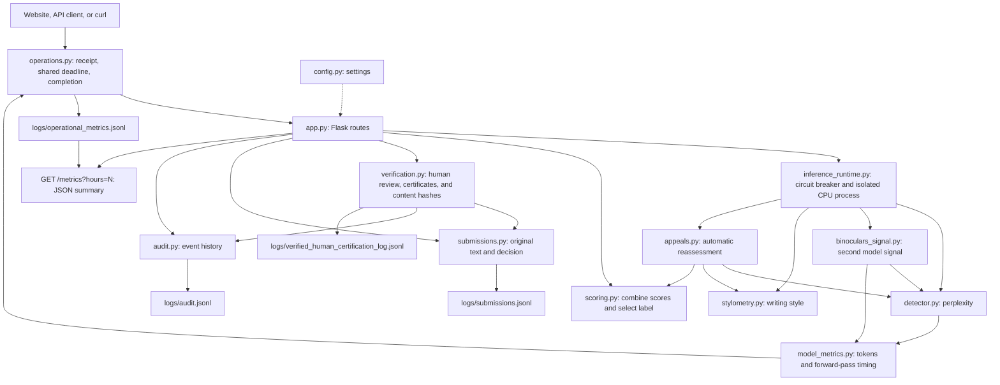
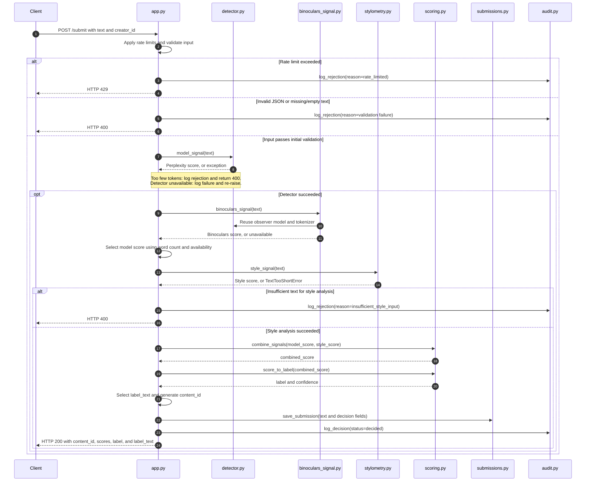
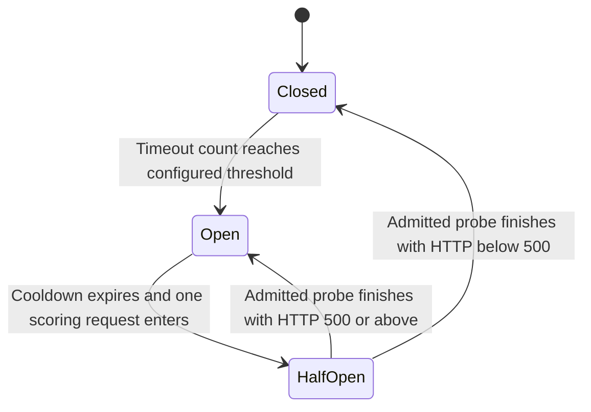
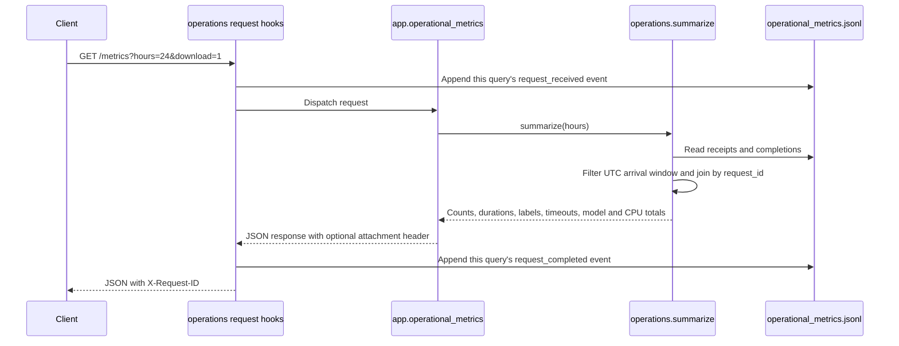
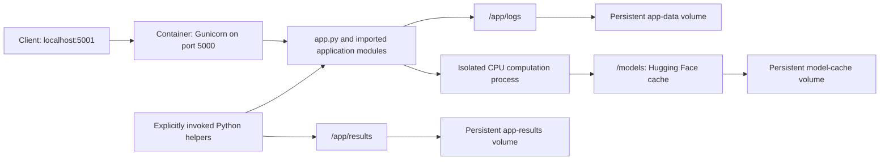

# Provenance Guard — Program Flow

This document describes the implemented submission, scoring, automatic appeal,
human-review, certificate verification, request deadlines, circuit breaker,
operational metrics, and storage paths. The API is defined in
[app.py](app.py); the other application modules are called from those routes.
A writing website, an API client, or `curl` can send requests to the same service.

The settings below follow the current source code. Some earlier README examples
describe different model configurations. Exact-text verification against a
certificate's saved content hash is described at the end of this document.

## Application components



[config.py](config.py) supplies model names, score weights, label boundaries,
rate limits, timeout/breaker flags, and file paths. Model inference, style analysis,
and automatic reassessment run in a separate persistent CPU process. It sends
measurements and results over a local pipe and never writes business records.
Flask owns the API, persistence, and operational logging. There are no separate
network services for these modules.

## API routes and the functions they call

The default Docker API address is `http://127.0.0.1:5001`; native Python defaults
to `http://127.0.0.1:5000`. **There is no homepage at `/`**: opening either base
address by itself returns 404. Open a complete GET URL in the browser:

- [Health and model readiness](http://127.0.0.1:5001/health)
- [Statistics for the last 24 hours](http://127.0.0.1:5001/metrics?hours=24)
- [Download the statistics as JSON](http://127.0.0.1:5001/metrics?hours=24&download=1)

Use the paths as listed, without an extra trailing slash. POST routes need a
POST request with a JSON body; opening them in a browser address bar sends GET
and returns 405. Docker and native Python use separate records unless their
storage has been explicitly configured to be shared.

| Route | Function in `app.py` | Work delegated to other modules |
| --- | --- | --- |
| `POST /ping` | `ping()` | Echoes a message and identifies the service. |
| `GET /health` | `health()` | Checks inference readiness, optional-performer state, timeout/breaker settings, rate limits, and audit-entry count. |
| `POST /submit` | `submit()` | Calls the detector, Binoculars, style analysis, scoring, submission storage, and audit logging. |
| `POST /appeal`, default or `review_type="automatic"` | `appeal()` | Loads the original text, calls `appeals.reassess()`, and logs acceptance and reassessment. |
| `POST /appeal`, `review_type="human_verification"` | `appeal()` | Calls `verification.request_review()`. |
| `GET /verification/review/<content_id>` | `get_verification_review()` | Calls `verification.review_details()`. |
| `POST /verification/review` | `review_verification()` | Calls `verification.review_content()`. |
| `POST /verification/verify` | `verify_certified_content()` | Calls `verification.verify_content()` to compare full-text SHA-256 hashes for one certificate ID. |
| `GET /content/<content_id>` | `get_content()` | Calls `verification.content_status()`. |
| `GET /log` | `get_log()` | Calls `audit.read_entries()` or `audit.entries_for()`; supports `limit` and `content_id` filters. |
| `GET /metrics?hours=N&download=1` | `operational_metrics()` | Calls `operations.summarize()` for windowed request, status, label, timeout, token, and CPU statistics. `download=1` is optional. |

## Startup and readiness

1. Importing `app.py` creates Flask and installs `operations.install(app)` before
   Flask-Limiter. Each request therefore starts its measurements before rate
   limiting or route validation.
2. With Gunicorn, `gunicorn_conf.post_worker_init()` starts
   `inference_runtime.engine`. Native `app.main()` also starts it, only in the
   serving process when Flask's debug reloader is enabled.
3. `InferenceProcess` spawns a CPU process. Its `_worker()` loads GPT-2 and tries
   to load the optional Binoculars performer, then reports readiness over a pipe.
   Loading is outside the request deadline; weights stay in the process for
   subsequent requests.
4. `/health` reads `engine.snapshot()`. `inference_ready` describes the primary
   detector; `binoculars_loaded` and `binoculars_startup_error` describe the
   optional performer. Primary-model startup failure prevents scoring. An
   optional-performer failure preserves the existing perplexity-only fallback.
5. Before readiness, a scoring request returns 503 `model_not_ready`. The HTTP
   service can still answer health, metrics, and certificate lookups. Docker's
   health check tests HTTP liveness; it does not require model readiness.
6. `gunicorn_conf.worker_exit()` closes the inference process; an `atexit` hook
   also registers cleanup. A scoring timeout kills and replaces the computation
   process. Idle-worker death is detected by a later health check, which starts
   a replacement. No abandoned scoring job is replayed.

## Submission and scoring

`POST /submit` accepts a JSON object with `text` and an optional `creator_id`.
An absent or invalid creator ID is stored as `unknown`.



The sequence above shows logical module calls. Perplexity, Binoculars, and style
calls cross `inference_runtime.call()` into the CPU process, all using the same
request deadline. Rate-limit and validation failures are measured before any
scoring starts. A timeout kills the compute process and returns 504 before saving
a submission; an open circuit, busy process, or unready model returns 503.

The current sequence runs model inference before checking the style minimums.
Style analysis requires at least three sentences and 40 word tokens. Its
measurements are sentence-length spread, structural punctuation density, and
vocabulary diversity using a 50-word MATTR window.

The detector uses `gpt2` by default, overridable through
`AI201_DETECTOR_MODEL`. Binoculars uses `distilgpt2` as its performer and reuses
the detector as its observer. The model inputs are truncated to 400 tokens;
the saved submission retains the complete text.

The current `/submit` rule is:

```text
If Binoculars succeeds and len(text.split()) >= 100:
    model_score = round(0.5 * perplexity_score + 0.5 * binoculars_score, 4)
Otherwise:
    model_score = perplexity_score

combined_score = 0.7 * model_score + 0.3 * style_score
confidence = combined_score
```

Binoculars is currently computed even below the 100-word inclusion threshold.
If it raises `DetectorUnavailable`, submission scoring falls back to perplexity.
The blend above is performed directly in `app.py`; this path does not call
`scoring.combine_model_signals()`.

| Combined score | Returned `label` and `guess` |
| --- | --- |
| `0.00 <= score <= 0.45` | `human` |
| `0.45 < score < 0.60` | `unsure` |
| `0.60 <= score <= 1.00` | `ai` |

The response includes `http_status`, `content_id`, `guess`, `label`, `label_text`,
`combined_score`, `confidence`, `model_score`, and `style_score`. Perplexity,
Binoculars, the inclusion flag, and word count are saved in the decision records
but are currently commented out of the response payload.

These scores are heuristics, not proof of authorship or calibrated probabilities.
Rate limiting is enabled for `/submit`: nine requests per minute and 400 per day,
applied independently to the IP address and each valid creator ID. Counts are
kept in memory and reset when the service process restarts.

## Automatic appeal

This is the default for `POST /appeal` when `review_type` is omitted. The caller
must provide an existing `content_id` and non-empty `reasoning`.

1. `app.py` finds the original decision with `audit.entries_for()`.
2. It calls `audit.log_appeal()` before inference, recording an `appeal_id`, the
   reasoning, and `status="under_review"`.
3. `submissions.for_decision()` retrieves the saved text. For older records, it
   can fall back to text embedded in the original audit decision.
4. `inference_runtime.call("appeal", original_text)` runs `appeals.reassess()` in
   the isolated process. It evaluates three variants: the original, the text
   without its first sentence, and the text without its last sentence.
5. Each usable variant receives a perplexity score and a style score, combined
   with weights of 60% model and 40% style. This appeal path does not call
   Binoculars. It uses the same final label thresholds as submissions.
6. A label with at least two votes wins. A three-way tie returns `unsure`.
   Missing text, insufficient text, or an unavailable detector produces an
   `unsure` vote for the affected variant, with a recorded reason.
7. `operations.before_persist()` checks the remaining request budget before
   `audit.log_appeal_result()` appends the reassessment. The response includes
   the label, message, votes, evaluations, and weights.

The original submission and decision remain unchanged. Automatic reassessment
keeps the appeal `under_review`; it does not issue a human-review certificate.
Malformed appeal input returns HTTP 400, and an unknown submission returns 404.
All three variants share the original request deadline. A timeout or inference
rejection can leave the initial appeal-acceptance event in the audit log; it
does not append a completed reassessment from abandoned work.

## Human review and certificates: who uses verification.py?

`app.py` imports [verification.py](verification.py) and calls it from five API
paths: requesting human review, retrieving review details, recording the
reviewer's decision, retrieving content status, and checking presented content
against a certificate. It also converts
`VerificationError` exceptions into JSON responses with the supplied HTTP code.

The diagram follows a valid new request and its first review decision. Error
responses and repeated decisions are described below it.

```mermaid
sequenceDiagram
    autonumber
    actor Writer
    actor Reviewer
    participant API as app.py
    participant Verification as verification.py
    participant Submissions as submissions.py
    participant Audit as audit.py
    participant Certificates as Certificate JSONL file

    Writer->>API: POST /appeal with human_verification, reasoning, additional_text
    API->>Verification: request_review(content_id, reasoning, additional_text)
    Verification->>Audit: Find original decision and previous reviews
    Verification->>Submissions: for_decision(original)
    Submissions-->>Verification: Original submission and creator
    Verification->>Certificates: Check for an existing certificate
    Verification->>Verification: Reject already-certified or pending-review requests
    Verification->>Audit: log_verification(event=human_verification_request)
    Verification-->>API: Request ID and under_review status
    API-->>Writer: HTTP 202

    Reviewer->>API: GET /verification/review/content_id
    API->>Verification: review_details(content_id)
    Verification->>Submissions: Retrieve original text
    Verification->>Audit: Retrieve decision and supporting evidence
    Verification->>Certificates: Retrieve any saved approval
    Verification-->>API: Submission, decision, review request, and outcome
    API-->>Reviewer: HTTP 200 with review details

    Reviewer->>API: POST /verification/review with content_id and status
    API->>Verification: review_content(content_id, status, reviewer, notes)
    Verification->>Verification: Validate request, original text, and previous decision
    alt New decision is certified
        Verification->>Verification: Hash complete original UTF-8 text with SHA-256
        Verification->>Verification: Certificate_id = final eight hash characters; capture UTC approval time
        Verification->>Verification: Check request deadline before persistence
        Verification->>Certificates: Append approval record, flush, and fsync
        Verification->>Audit: Append human_verification_review with credential
    else New decision is not_certified
        Verification->>Verification: Check request deadline before persistence
        Verification->>Audit: Append human_verification_review without credential
    end
    Verification-->>API: Saved review outcome
    API-->>Reviewer: HTTP 200 with status and credential or null

    Writer->>API: GET /content/content_id
    API->>Verification: content_status(content_id)
    Verification->>Audit: Read content history
    Verification->>Certificates: Find this item's certificate
    Verification-->>API: Status, credential, and review status when present
    API-->>Writer: HTTP 200
```

The review request must include non-empty `additional_text` containing the
supporting material. Requesting review does not grant a certificate. A reviewer
submits `status="certified"` or `status="not_certified"`; `reviewer` defaults to
`unspecified` and `review_notes` defaults to an empty string at the API boundary.
The current review endpoint does not authenticate the reviewer.

On approval, the credential contains `type="verified_human"`,
`method="draft_review"`, `Certificate_id=content_hash[-8:]` (eight lowercase hex
characters, no prefix), and `verified_dt_time` in UTC. New credentials also contain `hash_algorithm="sha256"`
and `content_hash`, computed from the complete original UTF-8 text. The same
credential is persisted in the certificate file and review audit event. The
surrounding review record ties it to a specific
`content_id`, creator, and verification request. Approval requires the original
text to be available and its creator to agree with the original decision.

Identical text approved under separate submissions shares a certificate ID and
full hash. Each approval appends its own history record with a distinct
`verification_request_id` and a UTC `timestamp` preserving microseconds. An
eight-character suffix can also be shared by different full hashes; lookup must
therefore compare the full hash. UUID-based historical certificate IDs are kept
unchanged and remain readable through their original IDs.

Verification changes are serialized with thread and file locks. Repeating the
same review decision returns the saved outcome and certificate; a conflicting
decision returns HTTP 409. A repeated approval can also recover the audit entry
if the certificate was saved but appending to the audit log failed. A declined
item can receive a new review request; an already-certified item cannot.

`content_status()` reads saved records without rescoring text. Its response
includes `content_id`, `status`, and `credential`; if a human-review request
exists, it also includes `verification_request_id` and `verification_status`.

## Records and their owners

The data files contain one JSON object per line and are created on first write.
The three business files are joined by `content_id`; operational receipts and
completions use `request_id` and include `content_id` when the response has one.

| File | Writer | Contents |
| --- | --- | --- |
| `logs/submissions.jsonl` | `submissions.save_submission()` | Complete original text, creator, timestamp, initial scores, label, and `decided` status. |
| `logs/audit.jsonl` | Helpers in `audit.py` | Initial decisions, submission rejections, automatic appeals and reassessments, human-review requests, and review outcomes. New submission decisions omit the full text; human-review requests include their supporting evidence. |
| `logs/verified_human_certification_log.jsonl` | `verification.review_content()` | Approved review records and credentials. Rejected reviews do not create certificate entries. |
| `logs/operational_metrics.jsonl` | Request hooks in `operations.py` | UTC arrivals/completions, route, HTTP status, wall/CPU seconds, label/result, historical timeout settings, circuit state, and per-model tokens and timings. No full request text. |

Reviews append new events rather than replacing the original submission.
The current-status endpoint combines the relevant saved history and certificate.
`GET /log` reads the audit file, not the submissions or certificate file directly.

Submission rejections have explicit audit entries. Validation failures on other
routes do not all append business audit events, but every Flask request is
instrumented by the operational hooks, including 400, 429, 500, and timeout
responses. The operational file keeps performance measurements separate from
the business audit trail.

Each writer creates its parent folder if missing. `operations.append()` uses a
thread lock and an exclusive file lock when appending operational records. If
the request receipt cannot be written, the request returns 503
`operational_log_unavailable` before business work. If completion logging fails
after work has run, the error goes to the console and the response carries
`X-Operational-Metrics: unavailable`; an existing committed result is preserved.

## Deadline and metrics lifecycle

These defaults are defined in [config.py](config.py):

| Setting | Default | Effect |
| --- | --- | --- |
| `REQUEST_TIMEOUT_ENABLED` | `True` | Enforce the shared processing deadline. |
| `REQUEST_TIMEOUT_SECONDS` | `3` | Budget for one request, across all its computation stages. |
| `INFERENCE_PROCESS_ENABLED` | `True` | Use an isolated process that can be stopped. Inline mode is for mock-based tests with the timeout disabled. |
| `CIRCUIT_BREAKER_ENABLED` | `True` | Gate scoring after repeated timeouts. |
| `CIRCUIT_BREAKER_FAILURE_THRESHOLD` | `3` | Consecutive scoring timeouts required to open the circuit. |
| `CIRCUIT_BREAKER_RECOVERY_SECONDS` | `30` | Cooldown before one recovery probe can enter. |
| `OPERATIONAL_METRICS_ENABLED` | `True` | Persist request receipts and completions. |
| `OPERATIONAL_LOG_FILENAME` | `operational_metrics.jsonl` | Performance/operations log under `LOG_DIR`. |
| `METRICS_DEFAULT_HOURS` / `METRICS_MAX_HOURS` | `24` / `720` | Default and maximum reporting window. |

The first seven settings accept environment overrides named `AI201_` followed
by the setting name; Boolean flags use `1` or `0`. Compose forwards the timeout,
breaker, and logging overrides and leaves process isolation enabled by default.
Timeout/recovery durations must be finite and positive, and the breaker threshold
must be at least one. Requests snapshot the settings they actually use, so later
reports retain historical values even after configuration changes and restarts.

1. The first Flask request hook snapshots the configured timeout and breaker
   settings, starts wall/thread CPU clocks, and writes a receipt. It runs before
   rate limiting, so a 429 still has an arrival and completion record.
2. Scoring checks the circuit, reserves the single inference slot, and sends work
   to the already-loaded process. Busy work returns 503 rather than waiting.
   Per-forward-pass token counts and timings stream back to the HTTP process.
3. All computation stages share the original deadline. On expiry, the worker is
   killed, partial measurements are retained, and the HTTP response is 504.
   Only model state is reloaded; an abandoned job is never replayed. Three
   consecutive scoring timeouts open the breaker for 30 seconds by default.
4. Successful mutations check the deadline before persistence. Completion hooks
   record HTTP status, duration, CPU, result, and measurements, then release the
   inference slot. `X-Request-ID` links the response to its operational records.
5. `GET /metrics?hours=N` joins receipts and completions once per request, using
   arrival timestamps within the window. It reports all HTTP status counts but
   counts submission and automatic-appeal labels separately. A receipt without a
   completion remains visible, including the metrics request currently running.



`CircuitBreaker.enter()` admits at most one probe in the half-open state. Other
scoring requests receive 503 `circuit_open` with `Retry-After`. An admitted
request ending with HTTP below 500 resets the closed circuit's timeout count;
the same result closes a half-open circuit. An unsuccessful probe starts a new
cooldown. Validation and rate-limit failures before circuit admission do not
change its state. The circuit does not gate health, metrics, or certificate
lookups, and its in-memory state resets when the HTTP worker restarts.

| Operational outcome | HTTP status and JSON error | Effect |
| --- | --- | --- |
| Request deadline expires | 504 `request_timeout` | Includes the request ID and timeout value; active computation is stopped. |
| Circuit open or another probe active | 503 `circuit_open` | Reject scoring with `Retry-After`. |
| Computation slot already reserved | 503 `inference_busy` | Reject with `Retry-After`; scoring requests do not queue for that slot. |
| Primary model not ready | 503 `model_not_ready` | Wait for readiness or investigate the startup error. |
| Computation process exits during work | 503 `inference_unavailable` | Record incomplete CPU measurement and discard the failed process. |
| Timeout enabled but process isolation disabled | 503 `invalid_timeout_configuration` | Reject scoring because it cannot enforce cancellation safely. |

### Token, wall-time, and CPU measurements

`detector.perplexity()` and `binoculars_signal.binoculars_score()` wrap each
forward pass with `model_metrics.forward_pass()`. Started/completed measurements
stream to the parent collector using a unique `call_id`, so an update replaces
the same call's initial record rather than counting it twice.

| Model / stage | Normal submission | Automatic appeal |
| --- | --- | --- |
| GPT-2 / `perplexity` | One forward pass | One pass per scorable variant, up to three |
| GPT-2 / `binoculars_observer` | One additional forward pass | Not called |
| DistilGPT-2 / `binoculars_performer` | One forward pass when available | Not called |

`input_tokens` counts actual tokenized inputs after the 400-token limit for each
started pass, including repeated uses of the same text. `completed_input_tokens`
counts only completed passes; `scored_tokens` counts the prediction positions
used by completed scoring passes. Both models generate **zero `output_tokens`**.
Style analysis uses the request budget and CPU accounting but is not a model
forward pass. Per-model results are keyed by the configured model name.

`duration_seconds` is wall time from the first Flask request hook through
response construction, before writing the completion record or sending the
response. `cpu_time_seconds` adds the HTTP handler thread's CPU time and the
computation process's reported CPU time. Model startup and idle time are excluded.
CPU time can exceed elapsed time because PyTorch uses multiple CPU threads.
When a worker is killed before its total is reported, the request CPU total is
`null` and `cpu_measurement_complete` is false; completed forward-pass measurements
remain available. These are local compute measurements, not API billing tokens.

The default three-second limit is a server processing budget, excluding network
and server queuing. Metadata/file handlers check it cooperatively; process
shutdown and I/O can add overhead. A committed mutation keeps its real success
status even if it finishes late, with `deadline_exceeded` recorded. See
[RUNNING.md](RUNNING.md#request-timeouts-circuit-breaker-and-operational-metrics)
for the flags, exact measurement definitions, and report download commands.

## Metrics query and JSON download

`GET /metrics` defaults to the last 24 hours. The `hours` query parameter accepts
positive fractional values up to 720; invalid values return 400. `download=1`
adds `Content-Disposition: attachment` with a filename such as
`operational-metrics-last-24-hours.json`. Both modes return `application/json`.



| Report field | Meaning |
| --- | --- |
| `window` | Requested hours, UTC start/end, and `received_at` as the time basis. |
| `requests_received`, `requests_completed`, `requests_without_completion` | Unique requests, not raw JSONL line counts. A missing completion can mean in-flight work or a process interruption. |
| `requests_by_route` | Received requests grouped by HTTP method and route. |
| `average_response_time_seconds`, `response_time_seconds` | Completed-request average, min, max, p50, and p95; `null` if no requests have completed. |
| `classification_counts`, `classification_scope` | `human`, `ai`, and `unsure` from successful `POST /submit` responses only; the scope field states this counting rule. |
| `appeal_classification_counts` | Automatic-appeal labels, counted separately from new submissions. |
| `http_status_counts` | Completed responses, including 200, 400, 429, 503, 504, and other observed statuses. |
| `timeout_count`, `timeout_configurations` | Timeouts and request counts grouped by the recorded timeout value and enabled flag. |
| `circuit_breaker_rejections`, `circuit_breaker` | Historical rejection count and current circuit snapshot. |
| `current_timeout_seconds` | Current configured limit; historical settings remain separate. |
| `models`, `cpu_seconds` | Model pass/token totals and measured request CPU totals, with incomplete measurements identified. |
| `malformed_records_skipped`, `recording_enabled`, `note` | Corrupt-record count, current logging flag, and report-counting caveats. |

The report includes all routes, including health checks and metrics queries.
The current query contributes a receipt but not its own completion to the
returned statistics. The file is scanned on each query; malformed rows are
skipped and counted. Logging can be disabled, but unrecorded traffic cannot be
reconstructed later. There is no automatic rotation; sufficiently large files
can exhaust the metrics query's time budget. File-read failures return 503
`operational_log_unavailable`.

```bash
curl -sS 'http://127.0.0.1:5001/metrics?hours=6&download=1' \
  -o operational-metrics.json
```

## Docker execution and persistent storage



[Dockerfile](Dockerfile) packages all root-level Python and Markdown files,
supporting documentation, and the small evaluation/attack fixtures allowed by
[.dockerignore](.dockerignore). Gunicorn starts `app:app` as a non-root user with
one HTTP worker, four threads, and debug mode disabled. `gunicorn_conf.py` starts
the isolated CPU process at worker initialization. The 300-second Gunicorn
watchdog is separate from the application's default three-second request budget.
[compose.yaml](compose.yaml) maps host port 5001 to container port 5000 on
loopback; every API route uses that same mapping. One HTTP worker shares the
in-memory rate limits and breaker, while its threads allow metadata requests
to run during scoring.

The `app-data` volume is mounted at `/app/logs`, so audit records, submissions,
certificates, and operational metrics survive container replacement. The separate
`model-cache` volume is mounted at `/models`, and `app-results` is mounted at `/app/results`
for helper outputs. None of these volumes is included when the image is
exported. The Docker installation starts with its own records and does not
automatically import the repository's existing logs.

Gunicorn's console logs are available through `docker compose logs app`.
The JSONL records are separate files inside `/app/logs`. All three mounted
directories are writable by the non-root application user. Download/preparation
helpers should direct their outputs to `/app/results`; Beemo uses that directory
as its working directory. See [RUNNING.md](RUNNING.md) for
startup, model preparation, and copying records out of the container.

## Supporting tools and documentation

These files are included in the Docker image. Helpers run explicitly via
`docker compose exec app python <script.py>`, rather than automatically by the
API. Markdown files remain documentation and evaluation inputs.

| Files | Role |
| --- | --- |
| `run_eval.py`, `scenarios.py`, `eval_samples/samples.json` | Run the existing five acceptance criteria in three trials, capture responses, and write results. The runner also snapshots `criteria.md` and source files. |
| `run_attacks.py`, `run_paced_attacks.py` | Exercise the live API with attack inputs and paced requests. |
| `calibrate.py`, `calibrate_combined.py`, `fit_perplexity.py` | Analyze model signals and candidate scoring settings using labeled samples. |
| `download_hc3_samples.py`, `prepare_calibration_samples.py`, `beemo_file_download.py` | Download or prepare datasets and sample inputs. |
| `test.py`, `test_*.py` | Check the environment and test application behavior. |
| `test_operations.py`, `test_content_verification.py` | Cover operational counts, process cancellation, circuit recovery, token measurements, exact-content hashes, and certificate compatibility. |
| `criteria.md`, `README.md`, `RUNNING.md`, `PROGRAM_FLOW.md` | Record acceptance targets, project evidence, operating instructions, and this flow. Flask does not use Markdown files to make scoring decisions. |

Dependencies are installed from `requirements-docker.lock`, generated using
`requirements-docker.in` and the original `requirements.txt`. The Docker input
also includes `scikit-learn` for fitting and `datasets` for Beemo downloads.
Source/docs and small fixtures are copied separately; existing logs, generated
results, and large downloaded datasets are excluded. Helpers that call the
running API from inside its container use `http://127.0.0.1:5000`.

## Verify content against a certificate

`POST /verification/verify` accepts a JSON object containing `certificate_id`
and `text`. `app.verify_certified_content()` validates the JSON object and calls
`verification.verify_content()`. That function:

1. Requires a non-empty certificate ID and text, then hashes the complete UTF-8
   text through `_content_hash()` without trimming, normalization, or model-token
   truncation. The same helper is used during certificate issuance.
2. Reads the certificate file under the same lock used for review writes.
   `_certificate_object()` rejects duplicate JSON field names, including nested
   credential fields, before any value can overwrite another. The lookup then
   finds the supplied ID in `credential.Certificate_id`.
3. Validates the matching records' approval metadata, full SHA-256 hashes, and
   certification dates. Eight-character IDs must equal the stored hash suffix.
   Conflicting copies of one `verification_request_id` are rejected.
4. Uses `hmac.compare_digest()` to find records whose full hash matches the
   presented text. Matching the short suffix alone never establishes verification.
5. Selects the matching record with the latest UTC approval timestamp, using
   append order only for exact timestamp ties. `_certification_time()` validates
   that its precise event timestamp and displayed UTC approval date agree.

The response is HTTP 200 with `verified: true` and `status: "verified"` for a
match, or `verified: false` and `status: "content_mismatch"` for different text.
Success includes the latest matching approval's `content_id`, `verified_dt_time`,
and precise ISO 8601 UTC `latest_certification_at`, alongside the certificate ID
and hash algorithm. Repeated certifications are valid history, not a duplicate-ID
error. If different full hashes share the short ID, each text resolves only to
its own matching history. A mismatch returns null timestamps, and also a null
content ID when the suffix spans multiple full hashes. Invalid input returns
400, an unknown ID returns 404, and unusable metadata or conflicting copies of
one approval activity return 409. An unreadable, malformed or duplicate-field certificate file returns
503. Certificate-validation errors include `verified: false`; shared operational
errors such as a request timeout can instead carry the generic error payload.

This operation does not run inference or alter the submission, certificate,
audit history, or content status. The saved hash remains usable after a process
restart and does not depend on rereading the current submission text. Old
certificates are not silently backfilled, and repeated approvals preserve the
original credential. Verification access also appears in Gunicorn's logs and in
the separate operational file, which captures `verified`, result status, HTTP
status, and request timing without changing the certificate or business audit.

The returned dates describe the latest successful certification of the presented
text under the supplied ID. A lookup does not refresh them. Retrying approval of
an already-approved submission also preserves its existing record; only a new
approved submission adds a certification activity. Content-status and review
detail endpoints retain their per-submission history.

The check establishes a match with this deployment's stored certified version.
It is not a public-key signature or an independent proof of human authorship;
it relies on the existing reviewer process and the integrity of stored records.

## New methods and changed entry points

The following inventory maps the new runtime methods and updated application
entry points to their roles. Hook names below `install()` are nested functions
registered on the Flask application, not separate API endpoints.

| Module | Methods / functions | Responsibility |
| --- | --- | --- |
| `operations.py` | `DeadlineExceeded`, `current()`, `check_deadline()`, `before_persist()` | Access request state, signal budget expiry, and guard successful writes. |
| `operations.py` | `RequestState.__init__()`, `RequestState.common()` | Initialize request ID, timers, configuration snapshot, collector, and shared event fields. |
| `operations.py` | `log_path()`, `append()` | Resolve and append to the separate operational file under locks. |
| `operations.py` | `install()`, `install.begin_request()` | Install hooks and record arrival before rate limiting. |
| `operations.py` | `install.timeout_response()`, `install.unavailable_response()` | Convert timeout and inference rejection into JSON 504/503 responses. |
| `operations.py` | `install.finish_request()`, `install.finish()`, `install.finish_failed_request()` | Finalize metrics, update the breaker, release computation reservation, and clean request context even on errors. |
| `operations.py` | `_timestamp()`, `_percentile()`, `summarize()` | Parse time windows, calculate latency percentiles, and aggregate deduplicated requests. |
| `inference_runtime.py` | `InferenceRejected.__init__()` | Carry a rejection code, message, and optional retry delay. |
| `inference_runtime.py` | `CircuitBreaker.__init__()`, `CircuitBreaker.enter()`, `CircuitBreaker.finish()`, `CircuitBreaker.snapshot()` | Initialize and transition the closed/open/half-open circuit and expose its state. |
| `inference_runtime.py` | `InferenceProcess.__init__()`, `InferenceProcess.start()`, `InferenceProcess.close()` | Own and manage the isolated process, pipe, guard, and per-request reservation. |
| `inference_runtime.py` | `InferenceProcess._start_locked()`, `InferenceProcess._stop_locked()`, `InferenceProcess._refresh_locked()` | Spawn/stop the process and consume startup or process-death state under its guard. |
| `inference_runtime.py` | `InferenceProcess.snapshot()`, `InferenceProcess.run()` | Expose readiness and execute work with the remaining request budget. |
| `inference_runtime.py` | `_worker()`, `_execute()` | Load models, dispatch perplexity/Binoculars/style/appeal jobs, and stream results and measurements. |
| `inference_runtime.py` | `call()`, `release()` | Apply deadline and circuit checks, reserve the computation slot, and release it on completion. |
| `model_metrics.py` | `Collector.__init__()`, `Collector.update()`, `begin()`, `end()` | Maintain a context-local call collector and optionally send updates over the pipe. |
| `model_metrics.py` | `forward_pass()`, `summarize()` | Measure model tokens and CPU/wall time, then aggregate by model name. |
| `gunicorn_conf.py` | `post_worker_init()`, `worker_exit()` | Start and close computation with the HTTP worker lifecycle. |
| `app.py` | `health()`, `main()` | Report readiness and operational settings; start computation for native serving. |
| `app.py` | `submit()`, `appeal()` | Delegate computation through the runtime and check the deadline before saving successful outcomes. |
| `app.py` | `verify_certified_content()`, `operational_metrics()` | Serve certificate hash checks and windowed operational JSON reports. |
| `detector.py`, `binoculars_signal.py` | `perplexity()`, `binoculars_score()` | Instrument existing forward passes without changing their scoring formula. |
| `verification.py` | `_content_hash()`, `_certification_time()`, `verify_content()` | Calculate full UTF-8 SHA-256 hashes, validate approval timestamps, and return the latest matching certification for the supplied ID. |
| `verification.py` | `_certificate_object()`, `_certificates()` | Read certificate records while rejecting duplicate field names at every JSON object level. |
| `verification.py` | `request_review()`, `review_content()` | Guard review writes with the deadline and store hashes for new approvals while preserving repeat-approval behavior. |

## Capstone measurement helpers

These host commands exercise the application in isolated Docker containers:

| File | Flow and output |
|---|---|
| `certification_data_requests/run_tests.py` | `Sandbox` sends curl requests and retains isolated logs; `evaluate()` and `case_passed()` score five cases for each of criteria 6–10 across three runs. |
| `certification_data_requests/check_duplicate_fields.py` | `main()` injects conflicting JSON fields into test records and saves three diagnostic trials with actual responses. |
| `certification_data_requests/measure_cost.py` | `main()` warms the models, measures ten assessments and ten verifications, and records a rejected request; `operational_records()` reads real completion events, while `summarize()` averages complete CPU measurements. |

The cost helper joins saved inputs/responses with `operations.install.finish()`
records and writes `measurements.jsonl`, compact `run_log.jsonl`, `summary.json`
and runtime metadata. Setup and inter-request waits are excluded from its means.
[Commands](certification_data_requests/COMMANDS.md) and
[submission status](SUBMISSION_CHECK.md) accompany the saved evidence.

View this file in a Markdown viewer that supports Mermaid to render the diagrams.
